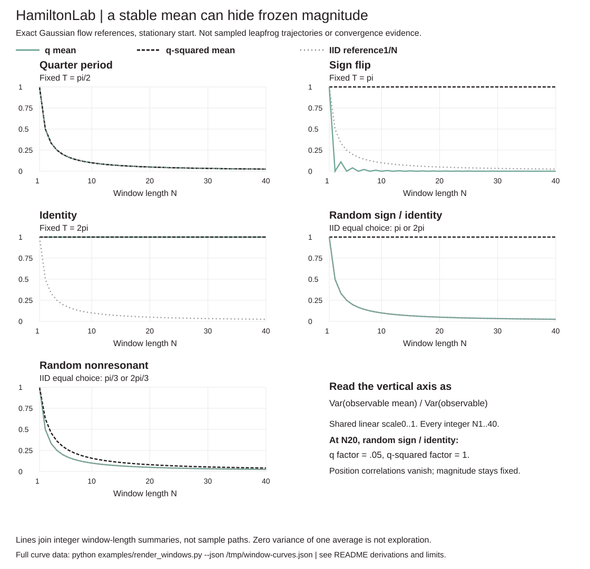

# Design and invariants

- Treat target callbacks as unnormalized potential+gradient pairs. Validate finite scalars/vectors and copy positions before callback invocation.
- Momentum covariance is mass; position velocity is momentum divided by mass. Identity mass is the demo default, not an inferred inverse covariance.
- Leapfrog's standalone output has unflipped momentum; the final sign flip needed for an involutive Metropolis phase-space proposal leaves position and kinetic energy unchanged. Each transition independently refreshes momentum and discards it after deciding.
- Return raw signed energy errors, not a thresholded divergence label. Invalid numerical trajectories are explicitly rejected; initial callback errors fail. No undocumented step-size repair.
- Log acceptance avoids exponentiating huge energy differences. Open-interval uniforms resample the exact zero PRNG outcome.
- Keep repeated rejected states. Warmup is discard-only and cannot be described as adaptation.
- Cache only current potential for random-walk acceptance; HMC deliberately re-evaluates initial potential/gradient each trajectory. One combined callback counter records actual work, including callbacks that raise. No speed claims from operation counts.
- All demo chains have equal retained lengths and distinct fixed seeds. Pooled covariance/occupancy are descriptive. Do not count transitions between chains or mistake fixed start proportions for observed mixing.
- Classical R-hat: W is average within-chain sample variance, B is n times sample variance of chain means, variance estimate=(n−1)/n*W+B/n, R-hat=sqrt(variance estimate/W). No split/rank normalization, no cap at1, null/status on W=0. No ESS/MCSE claim.
- Correlated target rho=.95; separated mixture centers±6 on x with identity component covariance. Exact known moments enable comparisons without fitting a density or using an evaluation model.
- Settings/starts selected for a readable development illustration. Same draws do not mean equal target work; the random-walk arm is not a tuned best-effort baseline.
- The figure shows first200 retained points per Gaussian chain, not an independent sample. Both Gaussian scatter axes are[-4,4]. The separate mixture panel shows all1000 retained x states per chain, axes time0..999/x[-12,12], with outside counts and no cross-chain joins. Full JSON keeps all states/transitions.
- Test invariants and finite-difference checks constrain implementation errors on tested inputs, not proof of reversibility, volume preservation or target invariance under arbitrary finite precision/callbacks.

Source: independently derived Python implementation of the mechanics described by Neal: https://ar5iv.labs.arxiv.org/html/1206.1901 . No copied implementation, modern sampler diagnostics, paper benchmark or performance guarantee.

## Quadratic resonance: stable, accepted and barely moving

A second failure needs no separated modes. On the standard2D Gaussian, identity mass and epsilon=sqrt(2), **four leapfrog steps are an identity map in exact arithmetic**. Refreshing momentum cannot fix a trajectory that returns to its starting position. Floating-point trajectories only move by tiny rounding errors. Linear stability and unit determinant do not imply exploration.

```sh
python -m hamiltonlab quadratic examples/quadratic.json
```

`quadratic_map(precision,mass,step_size,steps,position)` derives and composes the per-coordinate2x2 map for `U(q)=sum(k_i*q_i²/2)`. It returns the full one-step/trajectory maps, determinant, strict linear-stability indicator, Hamiltonian quadratic defect and conditional Gaussian proposal moments. These moments are **before Metropolis acceptance**, not the accepted-chain kernel or a mixing bound. The identity-resonance example is deliberate, not a tuning recommendation.

```text
A = [[1-epsilon²*k/(2*m), epsilon/m],
     [-epsilon*k*(1-epsilon²*k/(4*m)), 1-epsilon²*k/(2*m)]]
(q_new,p_new) = A^L * (q,p)
if first row of A^L is [a,b]:
  E[q_new | q] = a*q; Var[q_new | q] = b²*m
  E[(q_new-q)²], with stationary independent input q,p = (a-1)²/k + b²*m
Hamiltonian defect = transpose(A^L)*diag(k,1/m)*A^L - diag(k,1/m)
```

At epsilon=sqrt(2), k=m=1, one step has diagonal0 and off-diagonals sqrt(2),−1/sqrt(2); its fourth power is identity. The computed four-step map has first row `[1,1.256074e-15]`, conditional proposal variance1.577722e-30 and determinant1. The corresponding one-step proposal variance is2, **not** the target variance1: ignoring Metropolis would change the target. A proposal-map moment is not a post-acceptance guarantee.

Four standard-Gaussian chains use starts(-2,-2),(2,2),(-1,-1),(1,1), seeds71..74 and200 retained transitions without discard, same epsilon=sqrt(2):

| Fixed steps | Retained acceptance range | Largest coordinate span, max over chains | Mean squared accepted jump, range across chains |
|---|---|---|---|
| 1 | .570 to .710 | 6.231696 | 2.231222 to4.027284 |
| 4 | 1.000 to1.000 | 2.81e-14 | 1.29e-30 to1.80e-30 |

Each span/jump is computed within a chain, never across starts. Every state/rejection remains in JSON. Equal transition counts use different work: one step takes2 callback calls per transition, four steps take5, plus each chain's initial callback. No speed claim, sampler ranking or general optimal trajectory-length claim. The demo asserts both meaningful one-step motion and high-acceptance four-step stagnation. Original Gaussian/random-walk/mixture fields and SVG are unchanged.

Nine new tests check map vs actual leapfrog at multiple lengths with unequal precision/mass, energy-defect reconstruction, inverse/negative time, independent seeded conditional moments, determinant, joint precision/mass scaling, one-step variance mismatch, full-period resonance, stable-but-stagnant chains, invalid/nonfinite map inputs and CLI. **47 tests at the rank-diagnostic increment.** This algebra extends Neal's quadratic/leapfrog exposition; it is independently derived, with no copied code or paper performance claim. The map uses floating-point composition, not symbolic/interval arithmetic, exact-in-computer real arithmetic or a general target theorem. Precision/mass each lie in(0,1e4], step size has nonzero magnitude<=10, steps1..1000; nonfinite composed results fail. Only separable diagonal quadratics are covered. Arbitrary position-dependent Hessians, adaptation, stochastic gradients and accepted-kernel moments are not supplied.

## State-independent trajectory-length randomization

`sample(..., steps_range=[low,high])` optionally draws an inclusive discrete-uniform leapfrog length **before refreshing momentum on every transition**, independently of position, momentum, past acceptance and potential values. The range is fixed, not adapted. Each fixed-length Metropolis-corrected proposal is chosen with state-independent weight; this is not NUTS or a stopping rule based on the current trajectory. The sampler still does the ordinary energy accept/reject step and keeps repeated rejected states.

```sh
python -m hamiltonlab sample examples/random_length.json
```

The existing `sample` JSON accepts optional `steps_range` in addition to its required fields. `steps` remains required for schema compatibility but is ignored when a range is supplied. Output `steps` is then null, `steps_range` gives the actual range, each transition records `chosen_steps`, and `length_counts` covers **all** transitions, including discarded warmup and failed/rejected proposals. Actual callback counts include aborted trajectories. The maximum range endpoint drives the preflight work limit, rather than an optimistic average. Random-walk mode rejects this option. Bounds are integer1..1000, low<=high; singleton ranges are allowed. A supplied range consumes an extra random draw even when singleton, so it is not promised to reproduce a fixed-length seed stream. The default absent/null range preserves every previous fixed-setting output and random draw exactly.

For the same standard-Gaussian resonance starts, seed labels, epsilon=sqrt(2) and200 retained transitions, uniform lengths1..4 give:

| Chain seed | Counts L1 / L2 / L3 / L4 | Acceptance | Largest coordinate span | Mean squared accepted jump | Callback calls |
|---|---|---|---|---|---|
| 71 | 40 / 53 / 48 / 59 | .855 | 5.316326 | 4.188289 | 727 |
| 72 | 36 / 56 / 52 / 56 | .845 | 6.454790 | 2.961874 | 729 |
| 73 | 46 / 56 / 54 / 44 | .910 | 5.437958 | 6.141246 | 697 |
| 74 | 46 / 53 / 43 / 58 | .850 | 4.601358 | 3.302637 | 714 |

The four-step fixed arm remains unchanged: acceptance1, max span2.81e-14 and tiny squared jumps. The randomized arm moves on this deliberate resonance example, but these are **descriptive fixture comparisons** with different random streams and target work, not a controlled causal estimate or general improvement claim. Same seed labels do not mean paired momentum draws. Length2 may flip sign almost deterministically and length4 still nearly returns identity; the range includes both. Full JSON keeps the actual selections, acceptances and states rather than claiming every randomized proposal explores.

This option is not a solution to separated modes. A separate200-transition test starting at x=−6 in the original mixture, epsilon.15 and uniform lengths1..10, still makes zero mode switches. No mixing-time, convergence, calibrated-inference, acceptance-rate or efficiency guarantee follows from randomization. It does not adapt mass/step size or remove the need to inspect chains.

Nine added tests check unchanged default outputs, exact independently reproduced RNG consumption, state-independent length sequences from distant starts, inclusive endpoints/histograms, actual work counters, singleton range copying, retained rejection repeats, resonance motion, continued multimodal trapping, invalid ranges/work budgets and CLI. **47 tests at the rank-diagnostic increment.** All prior demo fields and SVG remain unchanged. Source: independently implemented state-independent length variation discussed in [Neal, Section4, periodicity and trajectory length](https://ar5iv.labs.arxiv.org/html/1206.1901). No reference code copied or paper performance claim.

## Rank-normalized split and folded chain checks

The original classical diagnostic remains unchanged. `rank_split_rhat(chains, include_audit=False)` adds a different check: split every retained chain into two halves; pool draws per coordinate; average tied ranks; map ranks to normal scores with the Blom offset; calculate the between/within ratio on those scores. Repeat after folding draws around the pooled median, then report the maximum of both components. Both component values, within/between variances and statuses are returned, not only the maximum.

```sh
python -m hamiltonlab diagnose examples/chains.json
```

The `diagnose` JSON has exactly `chains`: a list of retained2D chains, not sampler result objects. It returns full intermediate rank/fold/normal-score audit arrays. API callers can omit these arrays. Use **retained samples only**; this function does not infer or remove warmup from a plain list.

```text
r = pooled one-based rank, average ranks for exactly tied finite values
z = NormalInverseCDF((r-3/8)/(S+1/4))
folded_draw = abs(draw - pooled_median)
Rhat_max = max(Rhat(split rank scores), Rhat(split folded rank scores))
```

To avoid hidden draw dropping, this implementation requires equal **even lengths>=4**,2..64 chains and at most100,000 total2D draws. Every retained draw is used and dropped_draws=0 is returned. Odd or unequal chains fail cleanly instead of silently trimming or padding. All values must be finite. Zero within-component variance returns null/status; if **either** component is undefined, the maximum remains null too, even if the other component is computable. Such a result is not a pass. Values below1 are not clipped, no threshold is enforced, and no ESS/MCSE or convergence certificate is supplied.

Existing retained-chain x-coordinate results, without resampling:

| Fixture | Rank split | Folded rank split | Maximum |
|---|---|---|---|
| Correlated Gaussian HMC | 1.007774 | 1.001669 | 1.007774 |
| Correlated Gaussian random walk | 1.742260 | 1.331213 | 1.742260 |
| Separated mixture HMC | 1.733936 | 1.021593 | 1.733936 |

The mixture maximum is smaller than its classical x R-hat6.944902, but still flags a different location distribution across chains; these are different statistics, not evidence of better mixing. Diagnostics do not change samples, settings, acceptance or the previous outputs.

Two deterministic diagnostic counterexamples are included with their complete supplied sequences. They are **not generated MCMC chains or a benchmark**:

- **Scale difference:** four100-draw chains repeat `[-.5,.5,-1.5,1.5]`, two at scale1 and two at scale10 on x. Classical x R-hat0.994987 and rank split0.989949 look low; folded rank split2.117248 exposes different scales. Its y coordinate is identical across chains and is not silently described as failing.
- **Half-chain shift:** four identical100-draw chains contain50 negative draws alternating−2/−1 followed by50 positive draws alternating1/2. Classical R-hat0.994987 does not see between-chain differences, but rank split2.115500 exposes the within-chain shift. Folded component0.989949 stays visible.

A monotone transform preserves the bulk rank component as long as ordering/ties are unchanged. Do not generalize this to the folded component under arbitrary nonlinear transforms: folding around a median changes distances. Exact-tie handling and finite normal quantiles are auditable; this is not a claim that numerical values match every statistical package's edge-case conventions. In particular, null for a degenerate folded component is deliberate and conservative, not a package-compatibility assertion.

Nine added tests cover tie ranks/Blom inversion, all ties/symmetric scores, independent closed-form variance ratio, explicit split/fold ordering, affine/chain-order invariance, nonlinear bulk-rank invariance, no mutation, degenerate components, scale/half-chain counterexamples, limits and CLI. **47 tests at the rank-diagnostic increment.** All previous sampler/demo fields and the SVG remain unchanged. This is independently implemented from [Vehtari et al., Rank-normalization, folding, and localization, Sections4.1/4.2, equations14/15](https://arxiv.org/pdf/1903.08008). No reference implementation copied, no ESS implementation and no paper simulation/threshold guarantee claimed.

## Analytic harmonic flow and mass convention

```sh
python -m hamiltonlab harmonic examples/harmonic.json
```

`harmonic_audit(precision, mass, step_size, steps, position=None)` compares the existing finite leapfrog map with the analytic **unflipped** flow at exactly the same signed duration `T=step_size*steps`. This is a reference for a separable Gaussian `U(q)=sum(k_i*q_i²/2)`, not another sampler or a solution for the mixture/correlated targets. It does not change any sampler draws.

```text
omega = sqrt(k/m), theta = omega*T
[q(T)] = [ cos(theta)       sin(theta)/sqrt(k*m) ] [q(0)]
[p(T)]   [-sqrt(k*m)*sin(theta)   cos(theta)     ] [p(0)]
x = sqrt(k)*q, y = p/sqrt(m)
[x(T),y(T)] = clockwise rotation(theta) * [x(0),y(0)]
```

For independent stationary inputs `q~N(0,1/k), p~N(0,m)`, the exact rotation preserves their joint standardized identity covariance. Its conditional position variance is `sin²(theta)/k`, its stationary lag-one position correlation is `cos(theta)` and its expected squared jump is `((cos(theta)-1)²+sin²(theta))/k`. These are analytic properties of a **hypothetical exact-flow fresh-momentum kernel**, not estimates of the accepted leapfrog chain. Output retains both phase-space maps, their standardized error matrix/Frobenius norm, joint covariance pushforwards, and the leapfrog position variance's relative error **before** Metropolis. That pre-correction covariance is not the accepted chain's invariant covariance.

Mass means **momentum covariance M**, with kinetic energy `p²/(2m)`, not inverse mass. For diagonal precision `[1,100]` and `T=pi/2`:

| Analytic reference | Identity mass `[1,1]` | Precision mass `[1,100]` |
|---|---|---|
| Frequencies | 1,10 | 1,1 |
| Phases | pi/2,5pi | pi/2,pi/2 |
| Stiff coordinate conditional variance | 3.749399e-33 (roundoff near zero) | .01 |
| Stiff coordinate lag-one correlation | -1 | 6.123234e-17 (roundoff near zero) |
| Stiff coordinate standardized numerical-map error | 1.000863 | .001926 |

The last row is measured for the same epsilon `pi/32`,L16; it describes these specified linear systems, not general posterior tuning or speed. Setting `m=k` equalizes the two frequencies under this convention. Setting `m=1/k` instead gives frequencies1,100. No mass estimation or adaptation is performed.

Even perfect integration does not fix a poor duration. At `T=2pi`, precision mass makes the exact map almost identity in floating point; x expected squared jump is5.999039e-32. At `T=pi`, exact x squared jump is4 but conditional variance is1.499760e-32: position only flips sign, preserving its magnitude. Thus **large squared jumps, zero integration error and invariance do not prove exploration**. The supplied full-/half-period examples retain all matrices, not only those summaries.

A fixed-duration `T=1.3` refinement fixture, precision `[1,4]`,identity mass, compares the second coordinate's standardized numerical-map Frobenius error:

| Steps | 8 | 16 | 32 | 64 |
|---|---|---|---|---|
| Error | .018919629 | .004712811 | .001177146 | .000294221 |

Doubling steps at fixed duration gives ratios close to4 here, consistent with second-order leapfrog error. This is a deterministic development check, not a universal numerical bound or a benchmark. Ten new tests cover closed dynamics, exact energy/covariance/determinant, composition/inverse time, mass convention, quarter/half/full phases, pre-correction variance, second-order refinement, error matrices, no mutation, limits and CLI. **57 tests at the harmonic-reference increment.** All previous demo fields and SVG remain unchanged; only `harmonic_reference` is added.

Inputs inherit quadratic-map bounds: finite2D position, precision/mass in `(0,1e4]`, absolute step size in `(0,10]`,integer steps1..1000. Absolute harmonic phase must also be<=1e6; nonfinite maps/moments fail instead of becoming misleading JSON. The formulas use ordinary floating point, including roundoff near resonances, and are not certified exact arithmetic. This independent extension derives the diagonal-mass solution from [Neal's Hamilton equations and one-dimensional harmonic example, equations8..13](https://ar5iv.labs.arxiv.org/html/1206.1901); no reference code copied, timing/efficiency claim, adaptive tuning or convergence certificate.

## Finite-window observables: a mean can cancel while magnitude stays stuck

```sh
python -m hamiltonlab window examples/window.json
```

`finite_window_audit(precision, mass, step_size, steps, draws)` evaluates the variance of an average of N consecutive positions and of their squares under the **hypothetical stationary exact-flow Gaussian kernel**. It does not analyze the recorded leapfrog chains. Stationarity includes a random initial position drawn from the Gaussian target; these formulas do not include transient bias from a fixed start.

Full independent Gaussian momentum refresh makes each coordinate an AR(1) in exact dynamics:

```text
q_next = rho*q + sqrt((1-rho²)/k)*z, z~N(0,1), rho=cos(sqrt(k/m)*T)
Cov(q_t,q_(t+h)) = rho^h/k
E(q²)=1/k, Var(q²)=2/k²
Cov(q_t²,q_(t+h)²) = 2*rho^(2h)/k²
F_N(r) = [N + 2*sum_(h=1..N-1) (N-h)*r^h] / N²
Var(mean q) = F_N(rho)/k
Var(mean q²) = 2*F_N(rho²)/k²
```

The squared-position covariance follows directly by conditioning the Gaussian update: `E(q_(t+h)²|q_t)=rho^(2h)*q_t²+(1-rho^(2h))/k` and `E(q_t^4)=3/k²`. This is an analytic derivation for that specified kernel, not a normality test or a Gaussian approximation to another chain.

To avoid cancellation near negative unit correlation, the reported variance uses a nonnegative representation: `a_j=1+rho+...+rho^(j-1)`, `Var(sum Z)=a_N²+(1-rho²)*sum_(j=1..N-1)a_j²` for standardized covariance `rho^|i-j|`. It applies to q²'s covariance too, without claiming that q² has Gaussian innovations. Both this factor and the separate signed lag-sum factor are returned with their roundoff difference. Complete lag correlations, weights, weighted terms, initial coefficient and innovation coefficient sum remain in JSON. No hidden clipping of a negative signed sum is used.

For x precision1, precision mass and N20:

| Exact-flow duration | Variance of mean q | Variance of mean q² | q variance / IID mean variance | q² variance / IID mean variance |
|---|---|---|---|---|
| pi/2 (quarter period) | .05 | .1 | 1 | 1 |
| pi (sign flip) | 0 | 2 | 0 | 20 |
| 2pi (identity) | 1 | 2 | 20 | 20 |
| acos(-.8) | .006775890 | .406179404 | .135517797 | 4.061794036 |

At the sign flip, an even-window position mean cancels exactly but q² never averages away its random initial magnitude. For N21, position-mean variance is1/441=.002267574 while q²-mean variance remains2. Negative correlation can help one observable and hurt another. **Zero variance of one average is not evidence of exploration.** These are finite-window variances, not asymptotic ESS, a CLT, an MCSE estimate from data or an inference guarantee. The ordinary infinite-sum autocorrelation shortcut is not used at the nonergodic endpoints rho=+/-1.

Draw count must be an integer1..10000; other inputs inherit the harmonic/quadratic limits. Nonfinite stationary squared-position variances fail cleanly. Nine added tests compare direct covariance double sums, exact quarter/full/half phases including even/odd windows, every lag/weight/coefficient, negative-correlation observables, a seeded stationary exact-kernel simulation, bounds, no mutation and CLI. **66 tests at the fixed-window increment.** Only `finite_window_reference` is added to the demo; all previous fields and SVG stay unchanged. The diagonal Gaussian dynamics derive from [Neal's harmonic example and momentum-covariance convention, equations8..13](https://ar5iv.labs.arxiv.org/html/1206.1901); the finite-window covariance derivation is provided here independently, not copied reference code or a paper experiment.

## Random durations: zero position correlation is not independence

```sh
python -m hamiltonlab window-mixture examples/window_mixture.json
```

`mixture_window_audit(precision, mass, trajectories, draws)` extends the analytic stationary exact-flow reference to a finite list of equally likely trajectories. Each entry has exactly `step_size` and `steps`; duration is their product. A branch is drawn independently each transition, independently of state and fresh momentum. Duplicates retain their multiplicity, so `[A,A,B]` means probabilities2/3 and1/3. The same branch is shared across coordinates; only marginal q and q² covariances are reported, not independence of their joint processes.

For a coordinate, write `c_j=cos(sqrt(k/m)*T_j)`. Conditional expectations give different covariance rates for different observables:

```text
a = average_j c_j
b = average_j c_j²         # NOT a²
Cov(q_t,q_(t+h)) = a^h/k
Cov(q_t²,q_(t+h)²) = 2*b^h/k²
Var(mean q) = F_N(a)/k
Var(mean q²) = 2*F_N(b)/k²
b-a² = variance of branch cosines
```

The derivation conditions on one state-independent branch at a time: `E(q_next|q)=a*q` and `E(q_next²-1/k|q)=b*(q²-1/k)`. Iterating these expectations and using stationary Gaussian second/fourth moments gives the displayed covariances. No Gaussian joint-transition claim is needed: the random-duration transition is generally a mixture, not a Gaussian AR(1). Replacing b by a² would silently give the wrong uncertainty for q².

For x precision1, mass1, N20 and equal-probability two-branch schedules:

| Exact durations | a | b | a² | Variance of mean q | Variance of mean q² |
|---|---|---|---|---|---|
| pi or2pi | 0 | 1 | 0 | .05 | 2 |
| pi/3 or2pi/3 | 1.665335e-16 | .25 | 2.773339e-32 | .05 | .162222222 |

In the first schedule, independent choices between sign flip and identity make every nonzero-lag position correlation zero, but magnitude is unchanged forever. Its q-mean variance equals the IID value while its q²-mean variance is20 times the IID value. In the second schedule, position correlation is near zero, but q² remains correlated; its finite-window variance ratio is1.622222222, not1. These are different specified analytic kernels, not a controlled efficiency comparison or a general claim that random lengths fix mixing. Neither is the existing finite-step leapfrog random-length sampler.

JSON includes every branch duration, phase, probability and cosine, plus a, b, a², the nonnegative branch-cosine variance and both complete finite-window audits. Bounds are1..64 entries and1..10000 draws, plus the existing harmonic/quadratic bounds. Invalid/extra fields and nonfinite moments fail. Nine new tests cover singleton equality with the fixed reference, both counterexamples, exhaustive products over independent branch paths, multiplicity/order, no aliasing/mutation, seeded stationary exact-kernel simulation, maximum bounds and CLI. **75 tests at the random-duration increment.** Only `random_duration_window_reference` is added to the demo; all prior fields and SVG remain unchanged.

This extension independently derives marginal observable covariances from [Neal's harmonic dynamics and Gaussian momentum convention](https://ar5iv.labs.arxiv.org/html/1206.1901). No reference code or paper simulation is copied. Stationary initialization and IID state-independent branch choices are required. No result is a sampled-chain ESS/MCSE estimate, a CLT, a joint-process independence claim, an adaptive tuning recommendation or a convergence certificate. Floating-point trigonometric roundoff is retained rather than described as exact symbolic zeros.

## Reproducible observable-window figure



```sh
python examples/render_windows.py --check --json /tmp/window-curves.json
```

The deterministic renderer evaluates the existing analytic reference APIs for every integer N1..40, retaining all curve points in optional JSON. Five panels show a quarter period, sign flip, identity, random sign/identity and random nonresonant durations. All panels use identical **linear** horizontal N1..40 and vertical0..1 axes. The vertical value is `Var(mean observable)/Var(stationary observable)`, so q and q² are normalized by their own stationary variances. These are not absolute variances or variance ratios to an IID mean; the separate dotted IID curve is1/N. At N20, random sign/identity has q factor.05 but q² factor1.

Each line joins window-length summaries, not a sampled trajectory. All40 integer values are drawn without thinning, clipping, fitted smoothing or logarithmic zero replacement. Near-coincident curves are expected: quarter-period q/q²/IID match; identity q/q² match at1; random sign/identity q/IID match. Solid teal, dashed ink and dotted gray distinguish the series when they separate. The figure does not show empirical chains or prove mixing.

Seven new tests check all source N values/counterexamples, every rendered vertex against its data, shared-axis bounds, complete15x40 vertices, malformed/reordered/nonfinite inputs, XML label escaping, no mutation, deterministic committed SVG and JSON/check CLI. **82 tests total.** CI regenerates and byte-checks the figure. No demo result, reference formula or sampler draw is changed; the existing chain SVG also remains unchanged. Renderer and SVG are standard-library outputs with no plotting dependency.
